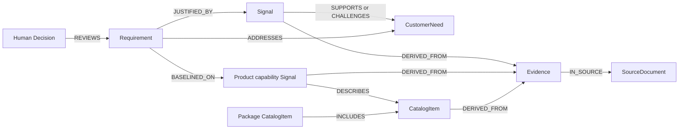

# BMW product decision ontology

Version **0.2.0** is a portable property-graph contract for deriving customer-facing
requirements for successor BMW vehicles. Pydantic models define payloads; Python
relationship rules define links; graph validation checks evidence, scope, product
baselines, measurements, revisions, and human review. The target horizon remains
three to five years, with customer value and measurable acceptance criteria.

The design follows the business-object, relationship, and validated-action principles
in [Palantir's ontology guidance](https://www.palantir.com/docs/foundry/ontology/ontology-best-practices/),
[link types](https://www.palantir.com/docs/foundry/object-link-types/link-types-overview/),
and [actions](https://www.palantir.com/docs/foundry/action-types/overview/).
BMWow separates stable domain identity from observations, preserves link direction,
and validates proposed changes against a complete snapshot. It does not implement
Foundry, its authorization system, or an OWL/RDF inference engine.

## Contracts and setup

- [schema.json](../contracts/ontology/schema.json): generated JSON Schema Draft 2020-12.
- [vocabulary.json](../contracts/ontology/vocabulary.json): generated object and relationship definitions.
- [agent-contracts.json](../contracts/ontology/agent-contracts.json): generated typed query/proposal interfaces.
- [source-mappings.json](../contracts/ontology/source-mappings.json): hand-maintained source adapter guidance.
- [synthetic.json](../contracts/ontology/examples/synthetic.json): invented catalogs, feedback, studies, sales, and web research.
- [web-research.md](web-research.md): proposed collection interface; no scraper is implemented.
- [ontology-consumers.md](ontology-consumers.md): four-question parking dossier, Signal kind rules, frontend/orchestration recipes, and rejected distinctions.
- [data-layer.md](data-layer.md): snapshot, SQL feedback, and combined read interfaces.
- [knowledge-ingestion.md](knowledge-ingestion.md): private curation/import commands and validated local candidate acceptance.

The Python reference implementation imports `bmwow.ontology`. Run from `python/`:

```sh
uv sync --locked
uv run bmwow-schema --check
uv run bmwow-validate ../contracts/ontology/examples/synthetic.json
uv run pytest
uv run ruff check .
uv run ruff format --check .
```

Edit `python/bmwow/ontology/models.py`, `relationships.py`, and the validator;
generate contracts with `uv run bmwow-schema`. Do not edit generated contracts by
hand. Shared fixtures use synthetic content. Real originals and derived examples
stay in ignored `raw_data/` or `data/`.

## Current knowledge implementation

`bmwow.knowledge` implements validated file snapshots, read-only Neon feedback,
and `CombinedKnowledgeService` behind the existing v1 interface. The combined
service uses explicit Derivate-to-VehicleModel mappings, unions dataset coverage,
and routes graph and SQL citations to their original backend. SQL feedback/aspects
remain read projections; combining reads does not persist them as graph Evidence
or Signals. The ontology and v1 wire contracts are unchanged.

The workbook importer creates source-versioned sales and study Evidence with
original cell/question/category locators. Reviewed exact study mappings can add
evidence-backed `study_finding` Signals. Proposed mappings do not establish Feature
associations. The curation template leaves segments, product metadata, Features,
and source populations for team review. A closed, reviewed catalog bundle can be
merged into the snapshot; full PDF extraction remains pending.

`FileCandidateStore` accepts graph candidates under a local writer lock, checks the
expected fingerprint, validates the complete merge, and replaces the JSON snapshot
atomically. It excludes Requirement/Decision nodes and relationships touching
existing Requirements/Decisions. Authentication and the requirement/review write
services remain application responsibilities. The optional analysis `store_findings`
hook is still unconnected; producing a finding does not accept it into the graph.

Private import and aggregate inspection commands are in
[the ingestion guide](knowledge-ingestion.md). The full requirement/review workflow,
TypeScript port, and Neo4j persistence remain later milestones.

## Questions this contract answers

1. What capability already exists, for which variant, market, and catalog edition?
2. Is it standard, optional, announced, unavailable, or unknown? Which package conditions apply?
3. Should a proposal introduce, improve, retain, or remove it, and what baseline proves that intent?
4. Which original passages or statistics support and challenge the need or implementation?
5. Are measurements comparable given units, test standards, configurations, questions, scales, and populations?
6. Which forecasts and assumptions need validation before successor launch?
7. Which exact revision did a human review, and did conflicting decisions remain visible?
8. Are frequencies counting classification rows, feedback records, respondents, or a defined survey population?



Feature and context references connect these paths to the same customer capability,
model, and market. The diagram shows relationship direction, not processing order.

## Object meanings

**SourceDocument** identifies one file/version, SQL source, or captured web page.
Keep origin, publisher, partial publication date, retrieval timestamp, location,
content hash when available, source role, independence group, and limitations.
A catalog edition is a SourceDocument, not another parallel object.

**Evidence** identifies an original excerpt, feedback record, or statistic with
its exact row/cell/page/web locator. A feedback record can preserve several raw
classifications. Generated interpretations never become original Evidence.

**Signal** is one scoped interpretation of Evidence. Its kinds are
`customer_feedback`, `public_sentiment`, `competitor_capability`,
`product_capability`, `study_finding`, `commercial_indicator`, and `trend_indicator`.
Distinguish reported experience, opinion, publisher claim, inference, and forecast.
Extraction confidence concerns the mapping, not the truth or customer importance
of the claim. Study findings derive from customer studies; commercial indicators
derive from sales datasets and do not automatically establish feature demand.

**CatalogItem** identifies an equipment option or package within one original
source edition. Preserve its supplied code, description, context, conditions,
notes, and provenance. A missing code is `null`; do not invent a BMW option code.
Its identity is separate from a capability Signal's interpreted availability or
performance claim. Technical performance Signals need not describe a CatalogItem.

**Feature** supplies canonical names for capabilities and experiences across raw
files and internet sources. Source VFC strings remain raw classifications and
reviewable aliases. Front and rear seat ventilation are different capabilities;
a package that bundles both does not make them one Feature.

**VehicleModel** identifies a BMW or competitor model, with generation, model year,
and variant when known. `IS_VARIANT_OF` connects a variant to its matching generation
object. A catalog month does not establish a model year. G60 and G68 remain separate
even when a sales source reports their combined total. Requirement model references
identify the existing BMW baseline, not asserted facts about a future model.

**Market** records a market group and explicitly configured country membership.
The source sales label `EU` means Europe; the study uses `EU` without exact country
coverage. Do not silently equate these groups with EU membership or map a feedback
country into them without a configured mapping.
The curation manifest keeps `market:sales:EU` and `market:studies:EU` distinct,
with unknown country populations. Feedback's operational `EU` query selects the
configured EU member-country group and retains each record's original country.
Matching short codes do not make those three populations equivalent.

**CustomerNeed** records a customer outcome synthesized from evidenced Signals.
Positive experiences can motivate retention. Negative experiences can motivate
improvement. Sentiment, importance, prevalence, and priority remain separate.

**Trend** synthesizes scoped indicators into observed direction, forecast, or a
mixture, with horizon, uncertainty, and assumptions. One article does not establish
widespread adoption.

**Assumption** records an unproven premise, why it matters, the impact if false,
and a validation plan. It stays distinguishable from original evidence.

**Requirement** records a successor proposal with customer value, change intent,
baseline status/rationale, scope, acceptance criteria, uncertainty, prioritization
rationale, and assumptions. Prioritization is inspectable reasoning; the ontology
does not prescribe scoring weights or multiply complaint counts by sales volumes.

**Decision** records an immutable human event: approve, reject, request changes,
set priority, or comment. It targets one exact Requirement revision. Review state
and priority are derived from events; extraction agents cannot assign them on a
Requirement. An application must authenticate the human issuing the event.

## Relationships and scope

- `Evidence IN_SOURCE SourceDocument`: original location.
- `Signal/CatalogItem DERIVED_FROM Evidence`: interpreted claim or source-edition item identity.
- `Trend DERIVED_FROM Signal/Evidence`: original indicator inputs.
- `Signal DESCRIBES CatalogItem`: capability claim about that identified offering.
- `package CatalogItem INCLUDES CatalogItem`: membership within the same source edition.
- `Signal/CatalogItem/CustomerNeed/Trend/Requirement CONCERNS Feature`: canonical subject.
- `Signal/Trend SUPPORTS CustomerNeed/Requirement/Assumption`: positive justification with rationale.
- `Signal/Trend CHALLENGES CustomerNeed/Requirement/Assumption`: opposing evidence or limitations.
- `Requirement ADDRESSES CustomerNeed`: intended customer outcome.
- `Requirement JUSTIFIED_BY Signal/Trend`: customer or future-facing reasoning.
- `Requirement BASELINED_ON product_capability Signal`: existing BMW offering used to classify the change.
- `Requirement/CustomerNeed/Trend DEPENDS_ON Assumption`: explicit inferential premise.
- `Decision REVIEWS Requirement`: exact-revision human review.
- `VehicleModel IS_VARIANT_OF VehicleModel`: explicit variant-to-generation ancestry.
- `VehicleModel COMPETES_WITH VehicleModel`: explained competitive selection, not proof of equivalent offerings.
- `new revision SUPERSEDES old revision`: history of the same logical entity and type.

Links are directed; incoming traversal reads the same stored edge in reverse, not
a duplicated inverse relationship. Every edge has an ID and rationale. An inference
across model, market, country, or engine scopes requires `context_transfer` when
validation detects the mismatch. That explanation does not itself prove relevance.
Context fields are authoritative; do not maintain conflicting ABOUT-style edges.

Catalog conditions use `{kind, catalog_item_ids, description}`. `requires_all`
means every referenced item is necessary; `requires_any` means an alternative;
`excludes` records incompatibility. These three kinds require item references.
`configuration`, `usage`, and `unknown` retain textual conditions without item
references. References and membership must stay within one catalog edition.
Membership and variant ancestry must be cycle-free. These are inspectable
constraints, not a complete vehicle configuration solver.

## Baselines and acceptance criteria

`improve`, `retain`, and `remove` require `baseline_status=known_present` and an
evidence-backed `BASELINED_ON` capability for the applicable BMW model/family and
canonical Feature. Available equipment does not establish that an individual
feedback author's car had it, or that its performance satisfies the need.
`announced` identifies a planned offering and cannot establish `known_present`.
When both are known, a capability's variant annotation must agree with its
explicitly referenced VehicleModel variant.

When supplied, `target_launch_year` equals the Requirement's creation year plus
`horizon_years`. Advancing the snapshot's `as_of` date does not shift that launch
year or invalidate an unchanged revision; a changed proposal needs a new revision.

`introduce` can use `known_absent` only with an explicit `unavailable` capability
claim. A catalog lookup that returns nothing remains `unknown`; it needs an explicit
baseline premise and validation plan in an Assumption. Introducing a known-present
capability is rejected. Graph validation requires a forward-looking Assumption;
whether its text adequately addresses the missing baseline remains semantic review.
Use `baseline_rationale` to explain the claim and any scope limits.

Criteria state whether a target is proposed, evidence-supported, or human-set.
An evidence-supported numerical target cites original Evidence; complaints alone
do not establish a cooling rate or usability threshold. Criteria include
`verification_method` (`user_study`, `benchmark_test`, `inspection`, `analysis`,
or `to_be_defined`) and `test_conditions`. Defined methods require conditions.
An incomplete method remains visible as `to_be_defined`; a service may impose
additional review readiness requirements before approval.

## Measurements and source interpretation

A Measurement has exactly one of scalar `value` or `value_range={minimum,maximum}`.
Keep units, statistic, period, temporal status, scale, sample count, denominator,
population, comparison basis, test standard, conditions, question, and response
category separate. Unknown information is explicit `null`, not inferred.
A single stated maximum driving range is a scalar `value`. The two endpoints of
`value_range` represent a source-reported interval, such as configuration-dependent
range; they are not required for every car-range measurement.

A genuine PDF interval is not a list of configuration alternatives. The inspected
G60 table distinguishes configuration-dependent WLTP range from standard/optional
AC charging power. Capture the former as a range; capture the latter as separate
scalar claims with availability and conditions. Preserve original excerpts,
column headers, units, and footnotes. Do not compute an interval midpoint or
silently compare WLTP with EPA. Charging durations and state-of-charge windows
also need their original units and conditions.

The supplied catalogs are German July 2026 baselines. They do not establish US or
China availability. Equipment packages can include options, require combinations,
or exclude trim choices. PDF text extraction can lose symbols and column alignment;
visually verify those mappings. A complete catalog parser remains to be built.

Means, response proportions, counts, and percentages have different meanings.
CN/EU study scale bounds and sample sizes are unavailable. US `Sample total=1`
is a normalized total, not a respondent count. Keep survey questions and response
categories so comparisons do not silently harmonize unlike measures.

Preserve explicit sales zeros. G60/G68 totals are one combined source group and
must not be copied to each model or allocated without evidence. The source's 2030
values are `source_reported_future` with unknown forecasting method. They are not
historical actuals or proven successor demand.

## Agent tools and LangChain integration

`python/bmwow/ontology/tools.py` provides deterministic helpers and Pydantic
inputs/outputs, with no LangChain dependency:

- `query_nodes(bundle, OntologyQuery)`: scoped object retrieval.
- `traverse(bundle, TraversalQuery)`: bounded incoming/outgoing relationship traversal.
- `trace_evidence(bundle, TraceQuery)`: paths to originals, including relevant opposing evidence.
- `get_requirement_context(bundle, RequirementQuery)`: baseline, needs, justifications, challenges, assumptions, and exact-revision decisions.
- `comparison_readiness(bundle, ComparisonQuery)`: comparison limitations; no invented normalization or ranking.
- `snapshot_fingerprint(bundle)`: deterministic snapshot identity.
- `validate_proposal(bundle, RequirementProposal, *, expected_fingerprint=None, actor_id=None)`: validate a candidate change against the base.
- `build_agent_contracts()`: portable JSON schemas for tool inputs and outputs.

Read helpers validate the closed graph before retrieval and return bounded,
deterministic results with truncation flags. A bounded result is a tool response,
not necessarily a complete GraphBundle suitable for graph validation.

Study and commercial signal temporal filters inherit a status only when every
direct Evidence input has a measurement with the same status. Missing or mixed
statuses remain `unknown`; a future sales indicator cannot silently become historical.
Queries filter explicit model, market, country, engine, and Feature references;
unknown context does not become universal coverage. Traversal follows stored edges.
Evidence tracing also follows context IDs, criterion Evidence references, and
recursive catalog/capability condition references. Those are returned separately
as `{source_id, field, target_id}` references, rather than invented stored edges.
`ready_for_review` comparison status does not imply proven equivalence or ranking.

The proposal helper accepts one software-authored Requirement and narrowly allowed
links to existing objects. It merges a candidate without mutating the original,
rejects overwritten IDs and human-authored decisions/targets, requires the next
revision and `SUPERSEDES` link, and validates the complete candidate. It returns
typed errors and a candidate GraphBundle or `None`. New revisions start unreviewed;
equal-time conflicting review events remain ambiguous.

The LangChain owner can wrap these functions with tools using their Pydantic
schemas and inject graph access/actor identity through runtime context. See
[LangChain tools](https://docs.langchain.com/oss/python/langchain/tools) and
[structured output](https://docs.langchain.com/oss/python/langchain/structured-output).
Trusted service parameters provide actor binding and an optional expected
fingerprint. Authentication, authorization, atomic persistence, and concurrent-write
control belong to the service rather than these domain helpers. The knowledge
layer's local candidate store implements atomic acceptance and stale-write checks
for non-Requirement candidates. It cannot persist the RequirementProposal result
or authenticate a human Decision; those integrations remain separate.

The former `bmwow.ontology.agent` module is now `bmwow.ontology.tools` to distinguish
these domain operations from actual AI agents. Public `from bmwow.ontology import ...`
imports, generated contract filenames, payloads, and ontology version remain stable.
Agents and workflows live in `python/bmwow/agent/` and are ported to `src/server/`.

## Identity, integration ownership, and validation

Nodes have immutable IDs, stable `entity_key` values, and positive revisions.
Identify original feedback by source/version plus raw ID; retain every classification
and locator. Count distinct Evidence keys for feedback-record frequency. These
files do not establish verified cross-source respondent identities.

Changing a Requirement creates a new revision. Review of revision 1 does not approve
revision 2. Preserve prior decisions and competing evidence. GraphBundle represents
a closed snapshot: every referenced node must be present. Validate a patch against
its merged snapshot before accepting it.

The SQL owner can retain raw columns and add adapters for Evidence, derived objects,
and links. Do not require raw SQL tables to mirror the ontology. The frontend owner
uses generated contracts and shows baselines, intent, support/challenge paths,
source locators, assumptions, criterion conditions, and revision-specific decisions.
The orchestration owner uses typed tools; collection tools capture original Evidence
through a separate ingestion path.

The validator checks structure, references, endpoint types, deduplication, evidence
chains, catalog edition/conditions, cycles, scope transfers, quantitative bounds,
future labels, baseline intent, assumptions, and exact-revision review. It cannot
establish source truth, representative sampling, engineering feasibility, realistic
targets, or whether a scope-transfer rationale is persuasive. Research and human
product review remain necessary.

Provenance also draws on [W3C PROV-O](https://www.w3.org/TR/prov-o/), without claiming
conformance. A directed multigraph or SQL object/link tables can store the contract.
The current knowledge implementation uses local JSON snapshots alongside the
existing Neon feedback tables. Storage does not redefine the ontology: Neo4j is
a later persistence/traversal evaluation, with no driver or graph database migration
implemented yet. Situation-analysis v1 uses the read bridge; the complete requirement
synthesis, review API, and frontend dossier integration remain pending.

## Migrating v0.1.0 consumers and local samples

This is a **breaking wire change**. Coordinate SQL adapters, orchestration, and
frontend consumers against the generated v0.2.0 contracts. Python import paths
and existing fixture IDs remain stable; changing only the version string is insufficient.

1. Set `ontology_version` to `0.2.0` after mapping the fields below.
2. Add `value_range`, `test_standard`, `conditions`, `question`, and
   `response_category` to every Measurement, including nested Capability measurements.
   Existing scalars retain `value` and use `value_range=null`; unknown metadata
   uses null or an empty condition list. Recover survey labels from original
   questions/response categories instead of inventing them.
3. Add `conditions=[]` to existing Capability payloads. Classify BMW catalog claims
   as `product_capability`; preserve existing competitor Signals. Study and sales
   interpretations now have explicit `study_finding` and `commercial_indicator` kinds.
4. Review each Requirement's intent. Populate `change_intent`, `baseline_status`,
   and `baseline_rationale`; add applicable baseline Signals and `BASELINED_ON`
   edges. Do not default every prior proposal to introduction or claim absence from
   missing data. For unknown introduction, explicitly discuss the missing baseline
   in an Assumption; the validator checks assumption links, not adequacy of its text.
5. Add criterion `verification_method` and `test_conditions`. If no procedure has
   been designed, use `to_be_defined` and retain the limitation for review.
6. Map packages/options into edition-specific CatalogItems where needed. Preserve
   original evidence and stable IDs; changing a proposal's meaning requires a new
   Requirement revision rather than carrying an old approval forward.
7. Run structural and complete graph validation, then review generated-contract drift.

The ignored `raw_data/ontology_examples/feedback-and-sales.json` is a legacy local
v0.1.0 example and is not silently rewritten or deleted. It requires these steps
before `bmwow-validate` can accept it. Its proposed 90% usability target was an author
example, not a measured result or BMW approval. The tracked synthetic fixture is
already migrated and contains wholly invented claims and values.
